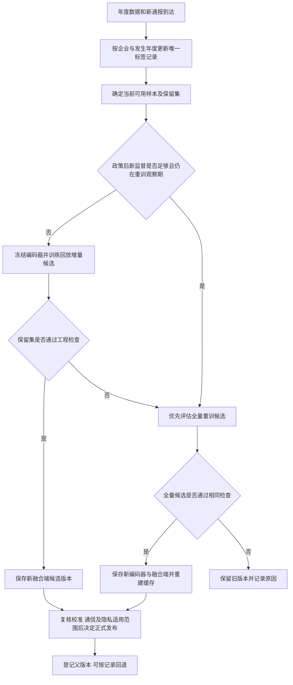

# 年度模型更新机制与项目收束说明

## 一、最终定位

项目保留已冻结FiLM-L风险排序主模型、MID经验隐私保护副模型及各自通信结果。新增年度维护机制作为拓展功能：平时冻结节点编码器，以修正标签和历史回放更新融合端；保留集显示退化时评估全量重训；候选均不通过时保留旧版本。

该机制已实现并完成两期、三个种子的研究回放。它是一套有退出与回退条件的更新流程，不把成熟的微调、回放或重训本身称为原创算法。正式六模型预测器未被本次三个独立种子替换。

## 二、更新流程

流程图中的研究接受不等于正式发布。实测为检验比较，两个候选分支均先计算；实际调度可在政策条件满足时直接进入全量分支。

## 三、具体规则

1. **标签更新。**新增通报先还原违规发生年度与类型。同一企业年度只保留一行当前标签；旧行由0变1或补充类型时，替换标签，不同时保留矛盾的新旧训练行。保留通报日期与父标签版本用于追溯。
2. **缓存。**按企业年度保存调制前h1/h2/h3、审计c/r及完整度q。标签变化不改变这些表示；新年度仅编码缺少的键。缓存键同时包含编码器、预处理和数据版本，任何一项变化即失效。
3. **增量训练。**节点编码器与审计编码器固定，只优化融合端。每步128条新增/修正行＋128条历史回放，60步；回放池最多2048条，采用当前标签。学习率和代价权重沿用小试，不新增调参。
4. **保留集。**按企业哈希保留20%，从不进入训练。检查2017固定锚点和最新可训练发生年，使用当前已公开标签；正例不足30时不自动通过。候选相对父版本任一组召回下降超过1pp或AP下降超过0.01，即触发全量评估。
5. **重训与保留。**全量重训30轮，重新学习编码器；使用相同当前保留集检查。仍失败则保留父模型，未消除的问题写入决策日志。门限是预定工程容差，不是统计显著性结论。
6. **版本发布。**版本记录父模型、标签截止日、文件哈希及编码器哈希。编码器变化即重建缓存；校准、量化决策保持、隐私适用范围及正式六模型聚合复核完成后才允许正式发布。本次所有版本标为research_only。
7. **回退。**根据当前版本parent找到保存的父模型，核对文件哈希后恢复；编码器若不同，相应缓存必须切换或重建。回退操作不覆盖历史文件。

核心优化仍是冻结表示上的经验风险最小化：

$$\min_\theta\; L_{\mathrm{新增及修正}}(\theta;\phi_{\mathrm{旧}})+\lambda L_{\mathrm{历史回放}}(\theta;\phi_{\mathrm{旧}}).$$

该式表达混合目标，实际实现按批次计算代价敏感总体损失及正例条件类型损失。新旧各半指样本采样比例，类型项按批内正例数归一化。没有新增参数距离约束，也不保证回放永不遗忘。

## 四、政策变化怎样接入

新《证券法》于2020年3月1日起施行，并强化信息披露义务、提高证券违法成本等，政策登记来源为[证监会公布的国务院办公厅通知](https://www.csrc.gov.cn/csrc/c100028/c1000829/content.shtml)。这提供了登记制度变化的依据，并不证明该日期造成某一模型退化。

本机制采用保守配置：以2021作为完整实施后的首个年度，至少有30条相关已记录正例进入训练后，优先进行两次全量更新评估；两次均指通过检查的更新，失败不扣次数。之后恢复普通增量规则。两次与30条都是本项目的操作参数，不是法律要求或经实证确定的最优窗口。

本轮最晚训练到2019，政策分支实际为等待新监督，不能验证政策后重训收益。已经用控制输入验证：提前不可见、监督不足等待、有监督后优先全量、失败不扣次数、两次成功后回归普通更新。不能把这些逻辑测试说成政策效果验证。

## 五、两期历史回放

起始模型只使用2019-04-30以前通报及<=2017输入；更新时点分别为2020-04-30和2021-04-30，训练截至2018和2019，后续评价2019和2020。评价统一使用截至2023-12-31记录标签。它与正式主模型三年成绩、Y60实验分别报告。

| 后续评价年 | 策略 | Recall@10% | AP | 当次计算时间 |
|---|---|---:|---:|---:|
|2019|不更新|29.11%|0.4962|0.000秒|
|2019|每期全量重训|30.67%|0.5309|8.022秒|
|2019|连续增量＋回放|30.05%|0.5176|0.193秒|
|2019|监测后选择更新|30.42%|0.5226|5.635秒|
|2020|不更新|30.20%|0.4536|0.000秒|
|2020|每期全量重训|32.61%|0.4969|8.624秒|
|2020|连续增量＋回放|31.05%|0.4801|0.175秒|
|2020|监测后选择更新|31.34%|0.4820|3.062秒|

更新选择实际发生如下：

| 种子 | 第一次选择 | 第二次选择 |
|---|---|---|
|42|全量重训|回放增量|
|100|回放增量|保留旧版|
|17|全量重训|回放增量|

机制确实执行了增量、全量和保留三个分支。seed100第二期的增量与全量候选均未通过保留集检查，因此保留旧版，而不是使用最终测试标签选择更好的候选。当前保留规则偏向旧期保持，未证实是后续年度收益最大的调度。

## 六、历史结构分析能支持什么

| 企业发生年 | 同为16个月时已记录违规比例 |
|---|---:|
|2017|13.33%|
|2018|15.89%|
|2019|15.24%|
|2020|14.19%|

上述比例控制了观察长度，但仍混合真实发生率、发现率与记录速度。逐年类型构成、原始已处理输入相对历史的标准化均值差均已保存。它们描述输入或标签边际变化，不能证明P(违规|节点表示)稳定。

连续增量相对每期全量的召回差：2019为-0.62pp，2020为-1.57pp。因此，不能据一次小试通过就宣布每年只微调足够。监测选择策略减少了部分更新时间、提高了旧期保持；它仍低于每期全量重训的后续平均召回，不能说自动门已保证非劣。

## 七、采用与停止决定

**采用为项目拓展成果：**支持延迟通报修正、节点表示缓存、融合端历史回放、保留集触发重训、失败保留和版本回退的一整套年度更新研究机制。原主模型不变，低成本更新作为条件性的维护配置。

**主张的证据：**单次小试中回放较普通微调更好保持旧期；两期回放实际走通三种更新分支；缓存接口检验了标签变化复用、新键编码和版本失效；保存48组召回率并独立复算，回退父文件逐项核对。

**不升级的主张：**每年只微调均可替代重训、已证明政策后的两年是最佳窗口、已在真实机构部署、以及更新后模型继承旧的通信/隐私安全结论。

**停止：**本轮机制、回放、来源、图表和交接文档齐备。停止新增架构与调参实验，转入最终汇报和材料归档；若未来真实合作部署，按已列发布条件执行，而非把该项作为本次结题的未完成训练任务。

## 八、操作入口与证据位置

- `config.json`：工程门、政策事件与发布条件。
- `mechanism.py`：候选审核、政策计数、缓存接口、发布判断和回退解析。
- `test_mechanism.py`：九项规则测试。
- `rolling.py`：两期真实回放，决策不读取后续评价标签。
- `results/versions.json`：模型版本、父版本和缓存兼容信息。
- `results/decisions.json`、`monitor_metrics.csv`：每次选择及当时保留集表现。
- `results/rolling_metrics.csv`、`summary.csv`：逐种子和汇总效果、时间及逻辑字节。
- `results/verification.json`：48组召回率复算、12个父版本回退检查及缓存语义测试。
- `results/policy_rule_trace.json`：政策分支的控制输入轨迹。

回放采用已有冻结特征快照，预处理与审计历史版本未重建；因此定位为更新机制验证。时间为单机计算，通信为逻辑张量账本。回放计时保守重建消息，真正按键复用的缓存接口另作语义检查，不将其混称实测网络加速。